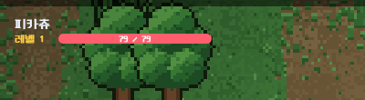
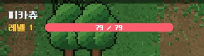
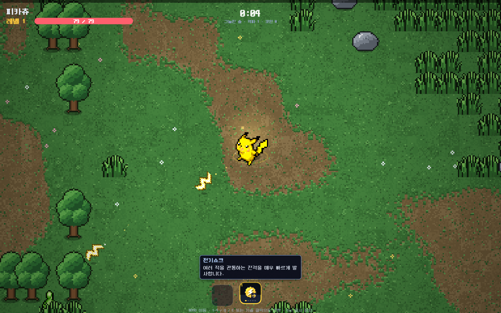
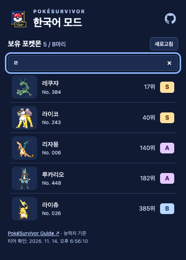

# PokéSurvivor Korean Patch

A Chrome extension for playing PokéSurvivor in Korean.

[**Install from the Chrome Web Store**](https://chromewebstore.google.com/detail/onfhhekmpdnbgpklcghiejdmgnbmjhci) · [Open game](https://pokesurvivor.com/) · [한국어](README.md)

## Getting started

1. Install the extension, then reload the game.
2. Choose **Settings → Graphics → Language → 한국어** in the game.

Chrome updates the store version automatically.

## Korean translation

Read the Pokédex, shop, missions, and move descriptions in Korean.

## Battle information

The Pokémon name, level, HP, and buffs in the top-left corner appear at 1.5× size.

| Default size | Enlarged · 1.5× |
| --- | --- |
|  |  |

The comparison shows the top-left display from the same battle scene.

Hover over a move or item slot at the bottom to read its description. Linked moves stack upward.

## Effect opacity

Adjust **My effects** and **Party effects** separately under **Settings → Graphics**. The images show the same scene with different player effect opacity settings.

| Default · 100% | Very transparent · 20% |
| --- | --- |
|  |  |

## Collection tiers and search

After starting the game, click the Chrome extension icon to see your Pokémon's tiers and overall rankings. Search by name, Pokédex number, or Korean initials (`ㅍㅋㅊ`). If the search finds no matches, it also checks misspellings such as `피카추`.

Rankings follow PokéSurvivor Guide's stat-based assessment. [Tier rating criteria](https://pokesurvivor.net/tier-list/)

An example collection filtered by the Korean initial consonant `ㄹ`.

## Direct P2P connection

Enable **Settings → Network → Direct P2P connection** to allow direct connections in multiplayer. It is off by default. Enable it on both PCs, then rejoin the room.

---

[Usage, ZIP installation, and updates (Korean)](docs/install.md) · [Report an issue](https://github.com/evan-choi/pokesurvivor-kor/issues/new?template=translation.yml) · [Privacy](https://evan-choi.github.io/pokesurvivor-kor/privacy.html)

[Development (Korean)](docs/development.md) · [License](LICENSE) · [Credits](THIRD_PARTY_NOTICES.md)
