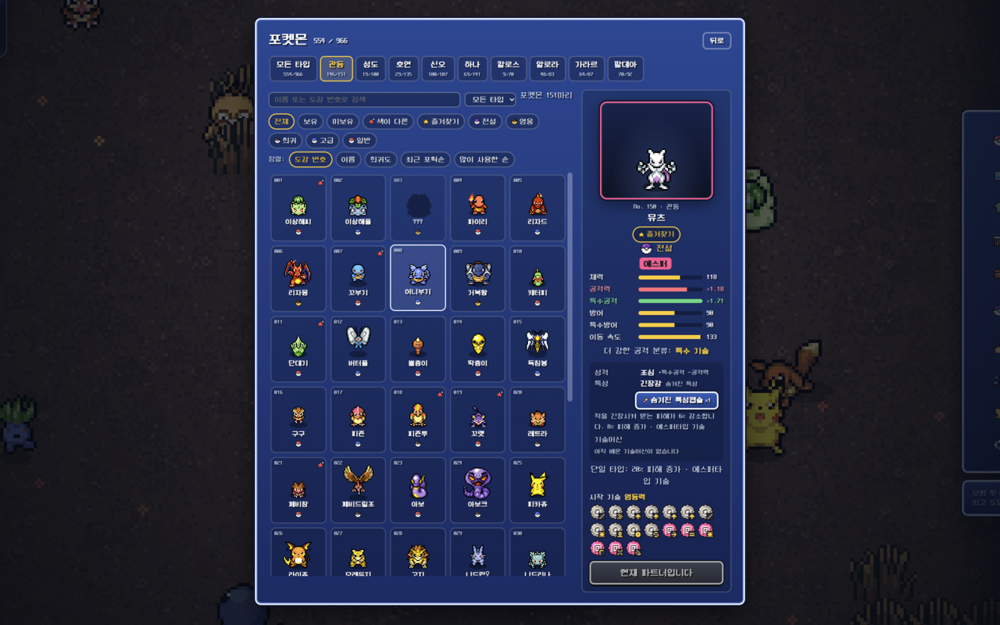
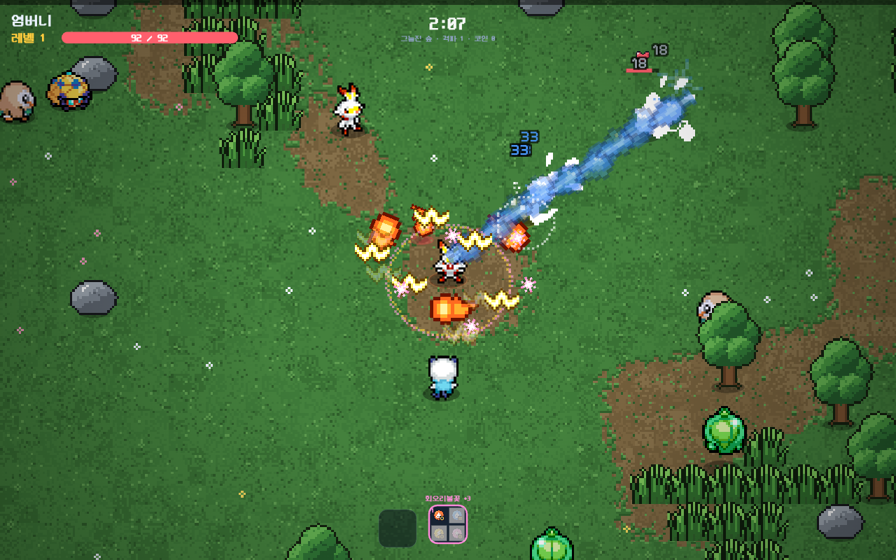
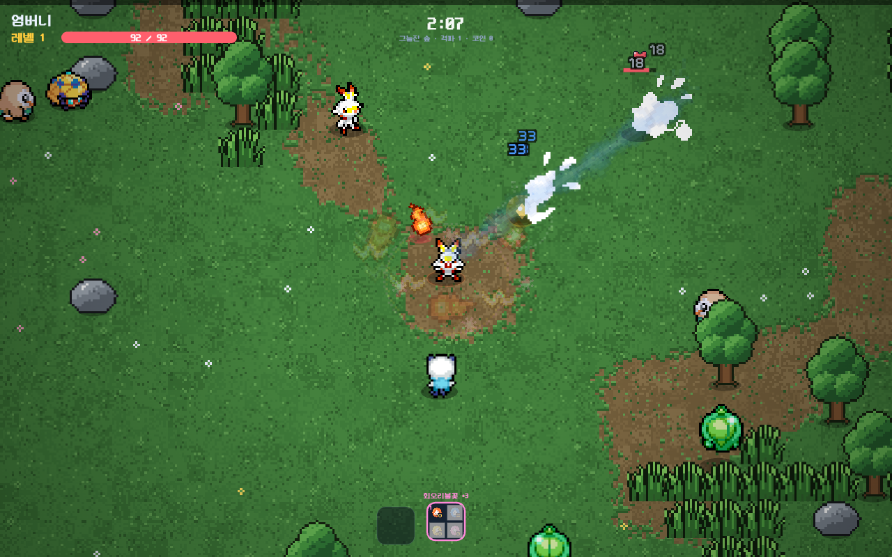
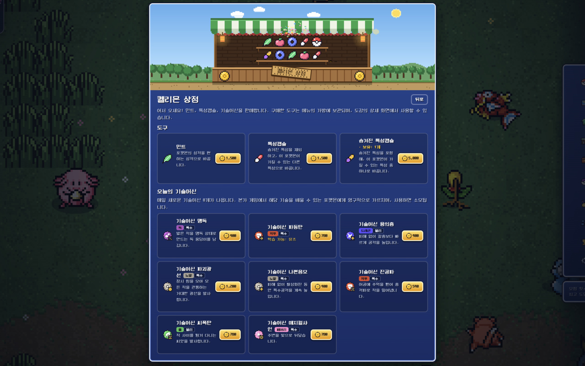
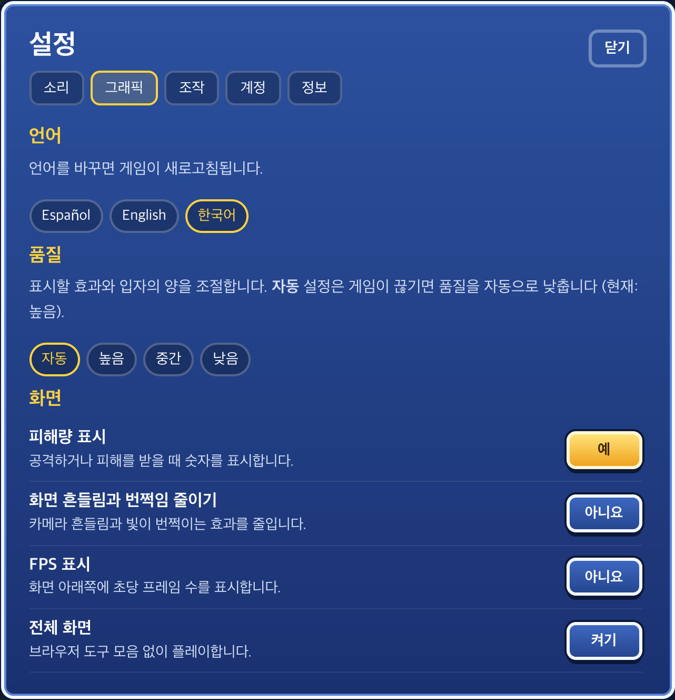
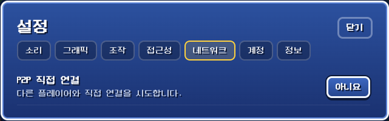

# PokéSurvivor Korean Patch

A Chrome extension for Korean translations and a clearer battle screen.

[**Add to Chrome →**](https://chromewebstore.google.com/detail/onfhhekmpdnbgpklcghiejdmgnbmjhci)　[Open game](https://pokesurvivor.com/)　[한국어](README.md)

After installing, reload the game and choose **Settings → Graphics → Language → 한국어**.

## Make the game easier to read

- **Korean translations** — Pokédex, shop, missions, and move descriptions.
- **Battle information** — 1.5× HUD plus move and item tooltips.
- **Your collection** — Click the extension icon to see tiers and rankings.

## Let effects take up less of the screen

Adjust your effects and party effects separately under **Settings → Graphics**.

| Default | Very transparent |
| --- | --- |
|  |  |

The same demonstration frame, with only player effect opacity changed from 100% to 20%. Damage calculations are unchanged.

Settings and additional features

| Feature | Location |
| --- | --- |
| Language · effect opacity | Settings → Graphics |
| Direct P2P connection | Settings → Network |
| Owned Pokémon tiers | Chrome extension icon |

[Usage guide (Korean)](docs/install.md) · [P2P connection guide (Korean)](docs/install.md#p2p-직접-연결)

More screenshots: shop and settings

---

[ZIP installation and updates (Korean)](docs/install.md) · [Report an issue](https://github.com/evan-choi/pokesurvivor-kor/issues/new?template=translation.yml) · [Privacy](https://evan-choi.github.io/pokesurvivor-kor/privacy.html)

[Development (Korean)](docs/development.md) · [License](LICENSE) · [Credits](THIRD_PARTY_NOTICES.md)
