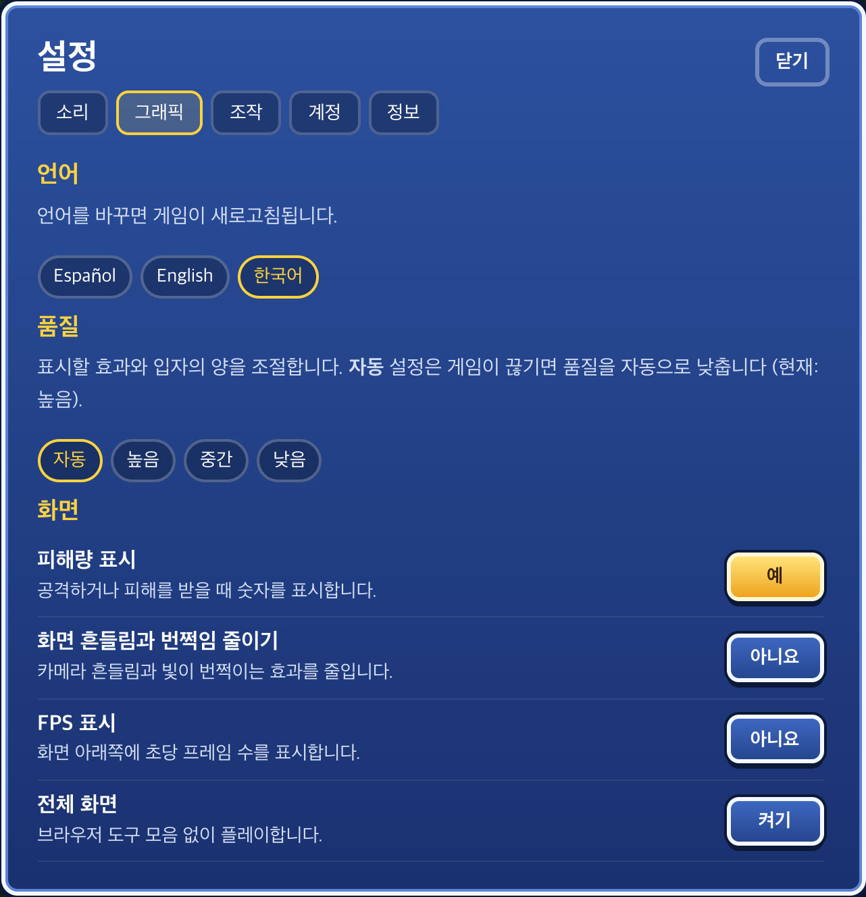

# PokeSurvivor 한국어 모드

메뉴, 포켓몬 이름, 기술 설명을 한국어로 바꾸는 Chrome 확장 프로그램입니다.

An unofficial PokeSurvivor Korean language patch for Chrome.

[**다운로드**](https://evan-choi.github.io/pokesurvivor-kor/downloads/pokesurvivor-korean.zip) · [프로젝트 소개](https://evan-choi.github.io/pokesurvivor-kor/) · [설치 방법](#설치) · [번역 제보](https://github.com/evan-choi/pokesurvivor-kor/issues/new?template=translation.yml) · [개발 안내](docs/development.md)

**한국어** · [English](README.en.md)

[포케서바이버(PokeSurvivor)](https://pokesurvivor.pro/play)의 비공식 한글패치입니다. 설치하면 게임 설정에서 한국어를 선택할 수 있습니다.

  

## 번역과 표시

설정, 도감, 강화, 미션, 업데이트 내역과 안내문을 번역합니다. 기술 설명, 레벨 상승 선택지, 전투 중 표시되는 문구에도 적용됩니다. 포켓몬 이름과 기술명도 한국어로 표시합니다.

한국어 글꼴과 줄 간격을 적용하고, 버튼과 카드의 정렬을 조정했습니다. 게임 안의 한국어 버튼이나 Chrome 툴바에서 번역을 켜고 끌 수 있습니다.

## 설치

**Chrome 119 이상**이 필요합니다.

1. [한글패치 ZIP](https://evan-choi.github.io/pokesurvivor-kor/downloads/pokesurvivor-korean.zip)을 내려받아 압축을 풉니다.
2. Chrome 주소창에 `chrome://extensions`를 입력합니다.
3. 오른쪽 위의 **개발자 모드**를 켭니다.
4. **압축해제된 확장 프로그램을 로드합니다** 버튼을 누릅니다.
5. 압축을 풀어 생긴 `pokesurvivor-korean` 폴더를 선택합니다. **`manifest.json`이 바로 들어 있는 폴더**입니다.
6. [게임 페이지](https://pokesurvivor.pro/play)를 열거나 새로고침합니다.

> 선택한 폴더를 열었을 때 `manifest.json`이 바로 보여야 합니다. 설치 후에는 해당 폴더를 이동하거나 삭제하지 마세요.

처음 설치하면 한국어 모드가 켜집니다. 업데이트할 때는 같은 위치의 확장 프로그램 파일을 최신 파일로 바꾼 뒤, `chrome://extensions`에서 확장 프로그램의 새로고침 버튼을 누르고 게임도 새로고침하세요.

폴더 선택 오류나 적용 문제가 있다면 [설치 도움말](docs/install.md)을 참고하세요.

저장소 소스 코드로 설치하는 경우

[저장소 ZIP](https://github.com/evan-choi/pokesurvivor-kor/archive/refs/heads/main.zip)을 내려받거나 Git으로 clone했다면 프로젝트 안의 **`extension/` 폴더**를 선택합니다. `npm run package` 또는 GitHub Actions에서 만든 설치용 ZIP은 최상위에 `manifest.json`을 포함하므로, 압축을 풀어 생긴 폴더 자체를 선택합니다.

## 언어 전환

- 게임의 **Settings → Graphics → Language → 한국어**를 선택합니다. 한국어 모드에서는 **설정 → 그래픽 → 언어**로 표시됩니다.
- **English** 또는 **Español**을 선택하면 한국어 모드가 꺼지고 게임의 원래 언어로 돌아갑니다.
- Chrome 툴바의 확장 프로그램 아이콘에서도 **한국어로 플레이**를 켜거나 끌 수 있습니다.

선택한 설정은 다음에 접속할 때도 유지됩니다. 원래 게임 언어를 바꾸면 게임이 새로고침될 수 있습니다.

## 번역 범위와 제한

게임 바깥의 사이트 안내문, 외부 로그인 페이지, 채팅·닉네임 등 사용자가 입력한 내용은 번역하지 않습니다. 게임이 번역하지 않도록 지정한 내용과 Arceus 등장 연출처럼 글자를 한 글자씩 그리는 일부 제목도 원래 표기를 유지합니다.

게임 업데이트로 문구가 바뀌면 일부 번역이 적용되지 않을 수 있습니다. 알 수 없는 문장은 원문을 유지합니다. 제품명·제작자명·단축키도 원래 표기를 사용합니다. 문제가 있다면 [번역 제보](https://github.com/evan-choi/pokesurvivor-kor/issues/new?template=translation.yml)에 화면과 원문을 남겨 주세요.

게임 계정·저장 데이터·점수는 바꾸지 않습니다.

## 개발 및 기여

번역 수정이나 개발에 참여하려면 [개발 안내](docs/development.md)와 [기여 안내](CONTRIBUTING.md)를 참고하세요.

## 라이선스와 출처

이 프로젝트는 [PolyForm Noncommercial 1.0.0](LICENSE)으로 배포합니다. 상업적 이용은 허용하지 않으며, 제3자 자료에는 각각의 원래 라이선스가 적용됩니다.

게임 문구는 공개 배포본 `c31715d-game-auth-popup-overlay-20261017`을 기준으로 작성했습니다. 배포본은 원저작자를 **JPTER78**, 코드 라이선스를 **PolyForm Noncommercial 1.0.0**으로 표시합니다. 원본 게임의 실행 코드, 개별 이미지·음악 파일은 배포하지 않습니다. 위 화면은 번역 결과를 보여 주는 게임 설정 화면입니다.

포켓몬·기술 명칭은 [PokéAPI](https://github.com/PokeAPI/pokeapi)의 한국어 데이터를 사용합니다. 출처와 BSD-3-Clause 고지 전문은 [THIRD_PARTY_NOTICES.md](THIRD_PARTY_NOTICES.md)에 있습니다. Pokémon 및 관련 명칭의 권리는 각 권리자에게 있으며, 이 확장 프로그램은 원본 게임 제작자나 권리자가 제공하는 공식 한국어판이 아닙니다.
